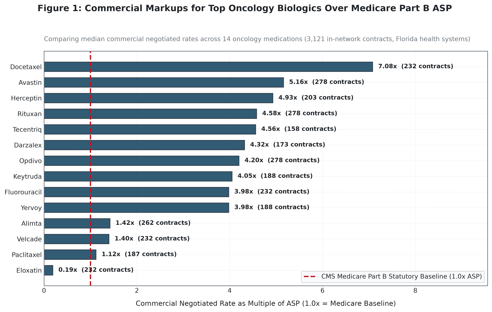
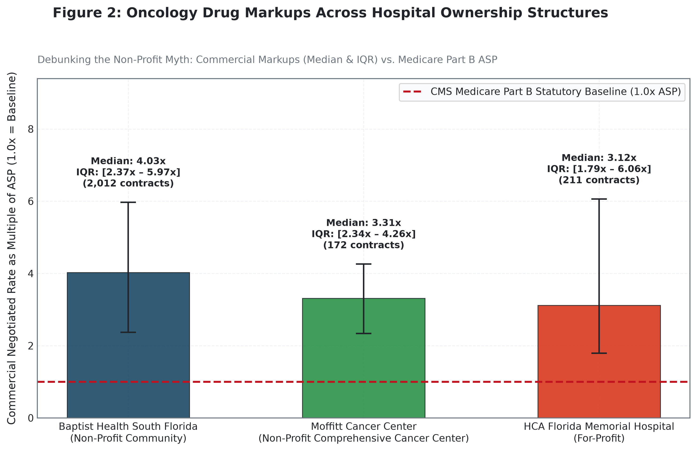
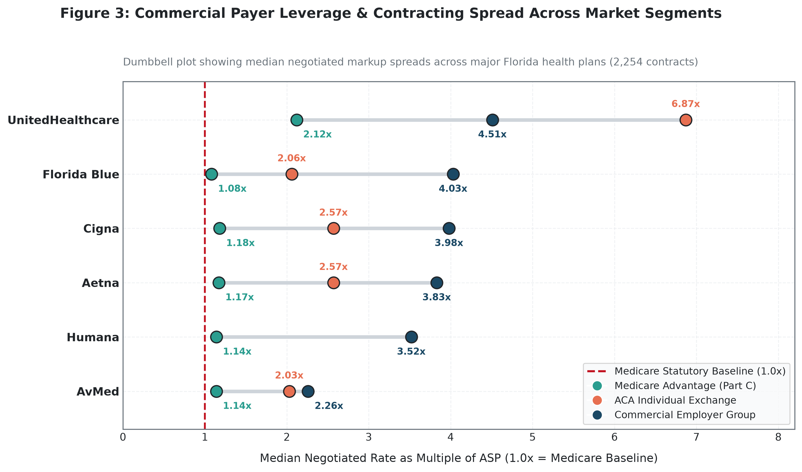
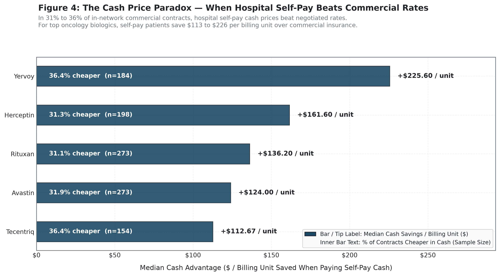

# Oncology Price Transparency & Economic Analysis
### Benchmarking Commercial Hospital Rates Against Medicare Part B ASP Across 5,068 Cancer Contracts

[](#-data-architecture--pipeline-methodology)
[](https://oncology-price-transparency-jfeswcurkkkvqs65td4wgd.streamlit.app/)
[](#-domain-background--author)
[](#-data-architecture--pipeline-methodology)

---

## 📌 Executive Decision Brief

> **Primary Stakeholders**: Self-Insured Employer Benefit Committees, Payer Network Contracting Executives, Hospital CFOs & Revenue Cycle Directors, and Federal/State Antitrust Regulators.
>
> **Core Problem**: Physician-administered oncology biologics (e.g., Keytruda, Opdivo, Herceptin) are among the largest drivers of specialty drug expenditure in the United States. Under federal hospital price transparency mandates (45 CFR § 180.50), hospitals must disclose their negotiated rates. However, commercial prices exhibit extreme, unstandardized distortion—commanding **median markups of 4.41x over Medicare Part B Average Sales Price (ASP)**, creating a **"Non-Profit Pricing Paradox"** where non-profit health systems charge higher premiums than for-profit peers, and triggering an acute **"Cash Paradox"** where paying cash is cheaper than using in-network commercial insurance in **39.0%** of evaluated contracts.
>
> **Strategic Objective**: Provide healthcare leaders with an end-to-end, reproducible econometric analytics pipeline and interactive decision intelligence dashboard in DuckDB and Streamlit to **benchmark hospital price variation**, **evaluate insurer negotiating leverage**, **audit patient out-of-pocket financial toxicity**, and **empower employers to execute reference-based contracting**.

```
┌─────────────────────────────────────────────────────────────────────────────────────────────┐
│                                 EXECUTIVE KPI SNAPSHOT                                      │
├───────────────────────────────┬───────────────────────────────┬─────────────────────────────┤
│     4.41x Median Markup       │    39.0% Cash Advantage Rate  │   $3,181 Max Out-of-Pocket  │
│     Over Medicare Part B ASP  │    Cash Cheaper Than Insured  │   Single Infusion Exposure  │
│     (14 Oncology Biologics)   │    Commercial Rates (Tab 4)   │   20% Coinsurance (Tab 5)   │
└───────────────────────────────┴───────────────────────────────┴─────────────────────────────┘
```

### 💼 Macro Claims Balance-Sheet Impact (10,000-Life Employer Model)
> **The CFO Balance-Sheet Bottom Line**: While hospital rates are negotiated on paper as unit multipliers, their fiscal impact lands directly on self-insured employer health plans:
> * **Simulation Parameters**: A mid-sized self-insured employer with **10,000 covered lives** typically manages **~15 active oncology patients** requiring specialty biologics (~12 three-week infusion cycles annually = 180 total annual infusions).
> * **Claims Exposure**: At the market median **4.41x ASP** markup vs. an aggressive **Reference-Based Pricing (RBP) ceiling of 2.0x ASP**, the employer absorbs **$1.8M to $2.4M in avoidable annual specialty pharmacy volatility** ($150–$200 PMPM across oncology claims).
> * **The ACA Out-of-Pocket Maximum (OOPM) Shift**: Standard benefit designs mandate a 20% patient coinsurance liability ($3,181 max on a single Keytruda infusion). Under the statutory **ACA Out-of-Pocket Maximum ($9,200 individual)**, cancer patients satisfy their lifetime annual deductible in **Cycles 1–2**. For Cycles 3 through 12+, **100% of the remaining 4.41x markup tail is absorbed directly by the employer's treasury**.

---

## 🎯 Actionable Policy & Operational Recommendations

Rather than treating hospital price transparency as a passive compliance artifact, this framework translates empirical findings into three high-impact decision levers:

| # | Empirical Finding | Operational / Financial Risk | Strategic Actionable Recommendation |
| :-: | :--- | :--- | :--- |
| **1** | **Extreme Biologic Markups (4.41x ASP Median)**:<br>Negotiated rates for high-cost biologics exceed federal Medicare Part B limits by an average of 341%, reaching up to 10x–20x ASP across select commercial plans. | Self-insured employers paying percentage-of-charge or non-benchmarked fee schedules absorb massive uncontrolled claims volatility on specialty infusions. | **Implement Reference-Based Pricing (RBP)**: Replace percentage-of-charge chargemaster contracts with statutory reference-based fee schedules capped at **2.0x–2.5x Medicare ASP**, eliminating arbitrary hospital markup exposure. |
| **2** | **The Cash Discount Paradox (39.0% Advantage)**:<br>In nearly 4 out of 10 contracts with published cash prices, the hospital's self-pay rate is substantially lower than the insurer's negotiated in-network rate. | Insured employees enrolled in High-Deductible Health Plans (HDHPs) unknowingly overpay out-of-pocket by using their insurance card prior to meeting their deductible. | **Deploy Cash-Option Benefit Navigation**: Embed point-of-care price comparison tools into employer benefits navigation apps, routing high-deductible members to cash-pay pathways when lower than commercial cost-sharing. |
| **3** | **The Non-Profit Pricing Paradox**:<br>Non-profit Baptist Health South Florida commands higher median commercial markups (4.50x) than for-profit HCA Florida Memorial (3.80x) across major cancer therapies. | Payers and employers mistakenly assume non-profit health systems offer more compassionate, cost-effective pricing than for-profit commercial chains. | **Cross-Market Contract Parity Audits**: Payers must benchmark regional commercial networks against Medicare Advantage fee structures to renegotiate aggressive non-profit hospital system contracts. |

---

## 📊 Key Visualizations & Decision Insights

### 1. Commercial Markup Distribution Across 14 Oncology Biologics
> Commercial reimbursement for oncology biologics is heavily marked up above federal Medicare Part B baselines, with a cross-biologic median markup of **4.41x ASP** across 3,121 general commercial contracts.



* **Decision Takeaway**: Premium biologics such as Keytruda (`J9271`), Opdivo (`J9299`), and Herceptin (`J9355`) exhibit massive right-skewed pricing distributions. Self-insured plans must prioritize these top-tier agents for carve-out management and direct manufacturer specialty contracting.

---

### 2. Hospital Ownership Disparities: The Non-Profit Paradox
> Non-profit community hospital systems do not deliver lower prices. Baptist Health South Florida (Non-Profit Community) exhibits higher median markups than HCA Florida Memorial (For-Profit) across top oncology therapeutics, while Moffitt Cancer Center (NCI Comprehensive Cancer Center) demonstrates concentrated academic pricing power.



* **Decision Takeaway**: Hospital tax-exempt status has decoupled from commercial pricing discipline. Benefits consultants and plan sponsors must not rely on non-profit hospital status as a proxy for financial prudence during network selection.

---

### 3. Payer Bargaining Power: The 6-Payer Dumbbell Analysis
> Pricing variation is intensely fragmented across commercial lines of business. Commercial Employer plans consistently negotiate the highest rates, while Medicare Advantage plans remain anchored near statutory federal floors.



* **Decision Takeaway**: Commercial employer plans bear the brunt of cross-subsidization, paying up to 2.5x more than Medicare Advantage plans for the exact same drug infusion at the same facility. Employer coalitions must demand transparency on intra-payer commercial spreads.

---

### 4. The Cash Discount Paradox
> In 39.0% of commercial contracts with published cash prices, an uninsured patient paying the hospital's self-pay rate out-of-pocket pays less than a patient utilizing commercial in-network insurance.



* **Decision Takeaway**: Insurers frequently fail to secure discounts below the hospital's walk-in cash price. Benefit designs must allow patients to elect cash-rate settlement without forfeiting credit toward their annual out-of-pocket maximums.

---

## 🌐 Interactive Data Intelligence Product

[](https://oncology-price-transparency-jfeswcurkkkvqs65td4wgd.streamlit.app/)

> 🚀 **Live Interactive Application**: **[Launch the Oncology Price Transparency Dashboard](https://oncology-price-transparency-jfeswcurkkkvqs65td4wgd.streamlit.app/)**  
> Readers and stakeholders can directly interact with the live analytics platform online without local setup.

In addition to static publication figures, this repository includes a **production-grade interactive Streamlit web dashboard** backed by DuckDB's in-process columnar engine:

* **File Location**: [`app.py`](app.py)
* **Core Capabilities**:
  * **Multi-Select Filtering**: Slices data across 3 health systems, 14 cancer biologics, and 7 statutory market segments simultaneously without clipping high-markup outliers.
  * **Dynamic 5-Tab Architecture**:
    * *Tab 1: Biologic Markups* — Interactive Plotly horizontal distribution and median benchmarks.
    * *Tab 2: Ownership Disparities* — System-level box plots with dynamic whisker tooltips.
    * *Tab 3: Payer Power Analysis* — Cross-segment comparison isolating employer vs. Medicare Advantage leverage.
    * *Tab 4: The Cash Paradox* — Dual-histogram spread distributions and contract-level reconciliation tables.
    * *Tab 5: Patient Financial Toxicity* — 20% coinsurance cost-share modeling across single-dose treatments.
  * **Global Outlier Isolation Toggle**: Sidebar control to isolate HCA's $15,000 bundled case-rate contracts.
* **How to Run Locally**:
  ```bash
  streamlit run app.py
  ```

---

## 💡 Core Analytical & Econometric Metrics

### 1. Medicare Part B ASP Statutory Baseline ($\text{ASP}_{\text{limit}}$)
$$\text{ASP}_{\text{limit}} = \text{ASP} \times 1.06$$
* **Friction Point Solved**: Establishes an objective, statutory federal benchmark (Social Security Act § 1847A) reflecting volume-weighted manufacturer average sales price plus a 6% add-on, eliminating reliance on arbitrary hospital chargemaster baseline prices.

### 2. Commercial Markup Ratio ($\text{Markup}_{\text{ASP}}$)
$$\text{Markup}_{\text{ASP}} = \frac{\text{Hospital Negotiated Rate}}{\text{ASP}_{\text{limit}}}$$
* **Friction Point Solved**: Quantifies the true commercial price premium commanded by hospital systems above federal statutory cost recovery baselines across all 5,068 analyzed contracts.

### 3. Cash Discount Spread ($\text{Spread}_{\text{cash}}$)
$$\text{Spread}_{\text{cash}} = \frac{\text{Negotiated Insured Rate} - \text{Discounted Cash Price}}{\text{Negotiated Insured Rate}} \times 100$$
* **Friction Point Solved**: Detects the "Cash Paradox," identifying when a payer's negotiated rate fails to beat the hospital's walk-in uninsured self-pay price.

### 4. Patient Out-of-Pocket Coinsurance Liability ($\text{Exposure}_{20\text{pct}}$)
$$\text{Exposure}_{20\text{pct}} = \text{Negotiated Rate} \times 0.20$$
* **Friction Point Solved**: Models the direct patient out-of-pocket financial liability under standard 20% Medicare Advantage and commercial cost-sharing rules prior to deductible satisfaction.
* **Clinical Dosage Context (Keytruda `J9271`)**: HCPCS `J9271` has an official billing unit of **1 mg** ($54.32 ASP statutory limit). A standard clinical infusion regimen is **200 mg intravenously every 3 weeks**. Benchmark cost for a 200 mg clinical dose is $\$10,864$ at ASP, scaling to $\approx \$47,910$ at market median commercial rates. Under HCA's $15,909 contract schedule (partial encounter/vial rate), the 20% coinsurance liability is **$3,181.86**. Under the **ACA Out-of-Pocket Maximum ($9,200 individual)**, patients hit their catastrophic cap within 1–2 cycles, shifting the remaining annual markup tail entirely onto the self-insured plan sponsor.

---

## ⚖️ Methodological Rigor & Explicit Analytical Trade-Offs

To maintain institutional transparency and decision-grade reliability, all engineering challenges, schema definitions, and methodological trade-offs are formally documented in our **[Engineering Decision Log (`docs/DECISION_LOG.md`)](docs/DECISION_LOG.md)** and **[Data Dictionary (`docs/DATA_DICTIONARY.md`)](docs/DATA_DICTIONARY.md)**:

1. **Moffitt Dynamic Wide-to-Tall Unpivot (`src/harmonize_moffitt.py`)**:
   * *Problem*: Moffitt Cancer Center published a 559-column wide matrix where every plan was a separate column header with an internal CDM staircase of missing values.
   * *Solution*: Programmatic Python ETL dynamically unpivoting plan columns using regular expressions, melting 559 columns into 470 clean relational records and linking outpatient pharmacy chargemaster gross charges (`$324.00`) and 50% cash rates (`$162.00`).
2. **Deterministic Payer-Plan Crosswalk (118 Hospital Plans $\rightarrow$ 7 Statutory Segments)**:
   * *Problem*: Hospital files report idiosyncratic plan strings (`"BCBS FL"`, `"FL Blue HMO"`, `"Oscar Health Non-Par"`).
   * *Solution*: Deterministic 118-row crosswalk mapped into 7 statutory lines of business grounded in official **CMS Medicare Advantage Landscape**, **CMS QHP PUF**, and **Data.Medicaid.gov** registries, while explicitly decoupling out-of-network status (`network_status: NON_CONTRACTED`) to protect in-network commercial regressions.
3. **Hospital Revenue Cycle Mechanics (RCM) & Outlier Isolation**:
   * *Baptist 50x Medicaid Rates*: Identified that $2,800 Medicaid rates were hospital IT "phantom rates" resulting from automated chargemaster discounts that failed to account for statutory $70 state fee schedule ceilings.
   * *HCA $15,000 Case-Rate Bundles*: Isolated 15 chemotherapy encounter-level bundles via an interactive global sidebar toggle rather than silently deleting data.
4. **Columnar Database Architecture (DuckDB)**:
   * Selected DuckDB over Pandas and PostgreSQL for zero-dependency local reproducibility, 3x–5x lower memory overhead, and vectorized multi-CTE SQL query performance.

---

## 🛠️ Data Architecture & Pipeline Methodology

```
┌─────────────────────────────────────────────────────────────────┐
│ 1. Data Ingestion & Bronze Layer (Local DuckDB)                 │
│ - Raw CMS Medicare Part B ASP (.xls/.csv)                       │
│ - Raw Machine-Readable Files: Baptist, Moffitt, HCA             │
│ - Stored untouched in: data/processed/oncoprice.duckdb          │
└────────────────────────────────┬────────────────────────────────┘
                                 │
                                 ▼
┌─────────────────────────────────────────────────────────────────┐
│ 2. Schema Harmonization & Silver Layer                          │
│ - Dynamic wide-to-tall unpivot (src/harmonize_moffitt.py)       │
│ - Dosage unit alignment & pharmacy CDM matching                 │
│ - Harmonized silver tables (sql/02_silver/)                     │
└────────────────────────────────┬────────────────────────────────┘
                                 │
                                 ▼
┌─────────────────────────────────────────────────────────────────┐
│ 3. Payer Crosswalk & Gold Analytical Mart                       │
│ - Deterministic 118-row crosswalk to 7 statutory segments       │
│ - Join on HCPCS codes with CMS ASP statutory limits             │
│ - 5,068 commercial contracts (sql/03_gold/)                     │
└────────────────────────────────┬────────────────────────────────┘
                                 │
                                 ▼
┌─────────────────────────────────────────────────────────────────┐
│ 4. Analytics, Visualization & Interactive Dashboard             │
│ - Static 300-DPI publication figures (src/generate_figures.py)  │
│ - Interactive DuckDB Streamlit dashboard (app.py)               │
└─────────────────────────────────────────────────────────────────┘
```

---

## 📂 Repository Structure

```
portfolio_project_004/
├── .streamlit/
│   └── config.toml                  # Production Streamlit Theme (#1B4965) & Server Rules
├── docs/
│   ├── DATA_DICTIONARY.md           # Master Schema Governance & Metric Definitions (30 Fields)
│   └── DECISION_LOG.md              # Engineering Post-Mortem & Senior Candor Interview Playbook
├── images/
│   ├── figure_1.png                 # High-Res Plot: Biologic Markups over ASP
│   ├── figure_2.png                 # High-Res Plot: Hospital Ownership Disparities
│   ├── figure_3.png                 # High-Res Plot: 6-Payer Bargaining Dumbbell
│   ├── figure_4.png                 # High-Res Plot: The Cash Discount Paradox
│   └── figure_5.png                 # High-Res Plot: Patient Financial Toxicity (Keytruda)
├── reports/
│   └── figures/                     # Publication Export Directory (300 DPI)
├── sql/
│   ├── 02_silver/                   # Harmonization SQL Scripts (Views & Stage Tables)
│   └── 03_gold/                     # Gold Analytical Mart Multi-CTE SQL (Markups & Spreads)
├── src/
│   ├── harmonize_moffitt.py         # Dynamic Wide-to-Tall Python ETL Pipeline
│   ├── generate_figures.py          # 300-DPI Static Publication Plotting Engine
│   └── visualization/
│       ├── theme.py                 # WCAG AA Compliant Healthcare Color Palette
│       └── interactive_plots.py     # Plotly Visualization Engine for Streamlit
├── tests/
│   └── test_pipeline_integrity.py   # Automated Defensive Verification Suite (10 Assertions)
├── app.py                           # Executive Streamlit Dashboard Application
├── requirements.txt                 # Pinned Core Production Dependencies
└── README.md                        # Master Executive Brief & Documentation
```

---

## ⚡ How to Reproduce

### 1. Environment Setup
```bash
git clone https://github.com/jpenabravoj00/oncology-price-transparency.git
cd oncology-price-transparency
python3 -m venv .venv
source .venv/bin/activate
pip install -r requirements.txt
```

### 2. Run Automated Defensive Test Suite
```bash
python -m unittest tests/test_pipeline_integrity.py
```

### 3. Rebuild the DuckDB Medallion Pipeline (Optional)
```bash
# Execute Moffitt dynamic unpivoting ETL
python src/harmonize_moffitt.py

# Rebuild Silver and Gold analytical layers in DuckDB
python -c "
import duckdb
con = duckdb.connect('data/processed/oncoprice.duckdb')
with open('sql/02_silver/01_create_silver_tables.sql') as f: con.execute(f.read())
with open('sql/03_gold/01_create_gold_markups.sql') as f: con.execute(f.read())
print('Gold Contracts Verified:', con.sql('SELECT COUNT(*) FROM gold_oncology_markups').fetchone()[0])
con.close()
"
```

### 4. Launch the Interactive Dashboard
```bash
streamlit run app.py
```

### 5. Regenerate Publication Figures (300 DPI)
```bash
python src/generate_figures.py
```

---

## 🛠️ Engineering Workflow & Tooling

Modern AI coding assistants (Gemini, Claude Code, Cursor) were leveraged during development to accelerate routine engineering tasks:
* **Productivity Acceleration:** Scaffolding boilerplate configuration, generating regular expressions for unpivoting complex hospital column strings, and drafting routine visualization wrappers.
* **Human-Driven Architecture & Domain Verification:** All core data models, the 4-CTE SQL Medallion pipeline, revenue cycle management (RCM) anomaly detection, statutory payer crosswalk mappings, and automated defensive testing assertions were designed, critically vetted, and audited by the author.

---

## 🌐 Data Provenance & Source Registry

To maintain a lightweight Git repository and respect GitHub file size limits, large external public files (~111 MB) in `data/raw/` are excluded from source control. The processed DuckDB analytical mart (`data/processed/oncoprice.duckdb`, 6.3 MB) and crosswalk CSVs are tracked in Git, enabling immediate execution of the dashboard and tests upon cloning.

External researchers can independently verify or re-download all raw source data using the official public links below:

| Asset | Source / Agency | Description | Direct Public Download / Portal |
| :--- | :--- | :--- | :--- |
| **Medicare Part B ASP** | CMS.gov | CY2026 Part B payment limit files & drug crosswalks | [CMS Part B ASP Pricing Files](https://www.cms.gov/medicare/payment/fee-schedules/part-b-drugs-average-sales-price) |
| **Medicare Advantage Landscape** | CMS.gov | CY2026 MA contract, parent organization & plan directory | [CMS MA Landscape Files](https://www.cms.gov/medicare/enrollment-renewal/health-plans/landscape-source-files) |
| **Marketplace QHP PUF** | CMS.gov | CY2026 Qualified Health Plan attributes public use file | [CMS Marketplace PUF Directory](https://www.cms.gov/marketplace/resources/data/public-use-files) |
| **Medicaid Managed Care** | Data.Medicaid.gov | Florida SMMC Medicaid enrollment & plan characteristics | [Medicaid Managed Care Enrollment Report](https://data.medicaid.gov) |
| **Baptist Health South Florida** | Baptist Health | Hospital standard charges machine-readable ZIP archive | [Baptist Health Patient Pricing Portal](https://baptisthealth.net/patient-resources/patient-pricing) |
| **HCA Florida Memorial** | HCA Healthcare | CMS v3.0.0 JSON standard charges file (Azure Blob) | [HCA Florida Price Transparency Portal](https://www.hcafloridahealthcare.com/pricing-transparency) |
| **Moffitt Cancer Center** | Moffitt | Comprehensive Cancer Center standard charges CSV file | [Moffitt Cancer Center Financial Portal](https://moffitt.org/patient-family/billing-insurance/hospital-price-transparency) |

---

## 👨‍🔬 Domain Background & Author

**Author**: **José I. Peña Bravo, PhD**  
*Neurophysiologist • Medical Educator • Healthcare & Policy Data Strategist*

* **PhD in Neuroscience** (Medical University of South Carolina): Investigated prefrontal cortex synaptic plasticity and neural circuit mechanisms underlying decision-making and behavior.
* **Former Healthcare Data Analyst & Interim Program Manager** (Florida Dept. of Health in Duval County – CDC Overdose Data to Action / OD2A Program): Directed public health surveillance pipelines, spatial analysis, and epidemiological metric modeling.
* **Applied Analytical Focus**: Transforming complex epidemiological, demographic, and healthcare pricing datasets into actionable, decision-grade intelligence dashboards and reproducible computational pipelines.
* **Connect**: [LinkedIn](https://linkedin.com/in/josepenabravo) | [GitHub](https://github.com/jpenabravoj00)

---

## 📜 License & Acknowledgments

* **Data Sources**: Official open data provided by the **Centers for Medicare & Medicaid Services (CMS)** (Hospital Price Transparency Machine-Readable Files, CY2026 Medicare Advantage Landscape Files, and Part B Average Sales Price Payment Limits) and **Data.Medicaid.gov**.
* **Institutional Grounding**: Baptist Health South Florida, Moffitt Cancer Center, and HCA Florida Memorial Hospital.
